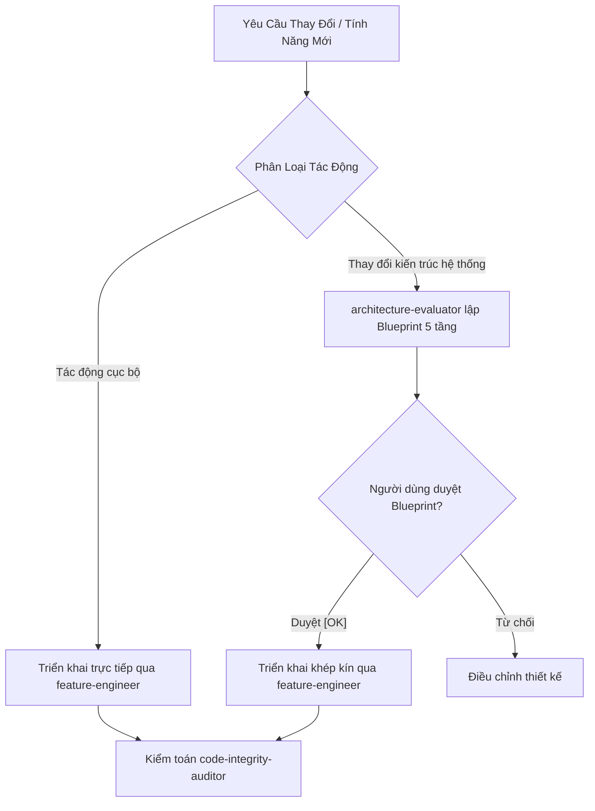

# Quy Chuẩn Kiến Trúc Hệ Thống (System Architecture & Impact Gate)

Tài liệu định nghĩa kiến trúc tổng thể, ranh giới 3 tầng bất biến và cổng kiểm soát thay đổi kiến trúc cho toàn bộ dự án KLTN2026-2027 Flutter Mobile Client.

---

## 1. Cổng Đánh Giá Tác Động Kiến Trúc (Architectural Impact Gate)

> [!IMPORTANT]
> Mọi thay đổi mã nguồn phải được phân loại mức độ tác động trước khi viết code. Tuyệt đối không tự ý thay đổi luồng điều phối, hợp đồng abstractions hay cấu trúc phân tầng mà chưa được người dùng phê duyệt.



### Tiêu chí phân loại:
1. **Tác Động Cục Bộ (Local Changes):**
   - Thêm trường hiển thị vào Entity/DTO đã có.
   - Thêm UseCase đơn lẻ theo mẫu chuẩn.
   - Sửa lỗi hiển thị widget, chỉnh sửa style giao diện.
   - $\rightarrow$ Triển khai trực tiếp, tuân thủ các quy tắc phân tầng.
2. **Thay Đổi Kiến Trúc Hệ Thống (Architectural Changes):**
   - Thêm phân hệ lớn hoặc màn hình chức năng mới hoàn toàn.
   - Thay đổi mô hình quản lý phiên đăng nhập, auth token, hoặc ActiveClubContext.
   - Đổi hợp đồng cơ sở (`BaseRemoteDatasource`, `AppException`, `ResponsiveLayout`).
   - Tích hợp SDK hoặc thư viện nền tảng mới vào `pubspec.yaml`.
   - $\rightarrow$ **BẮT BUỘC** ủy thác [`architecture-evaluator`](.agents/agents/architecture-evaluator.md) lập Blueprint 5 tầng kèm sơ đồ Mermaid trình người dùng phê duyệt trước khi viết mã.

---

## 2. Ranh Giới 3 Tầng Clean Architecture Bất Biến

```text
┌─────────────────────────────────────────────────────────────┐
│                   Presentation / UI Layer                   │
│   (Screens [ResponsiveLayout], Widgets, ViewModels [State]) │
└──────────────────────────────┬──────────────────────────────┘
                               │ phụ thuộc vào (Imports)
                               ▼
┌─────────────────────────────────────────────────────────────┐
│                        Domain Layer                         │
│         (Entities, Repository Interfaces, UseCases)         │
│                     [Pure Dart 100%]                        │
└──────────────────────────────▲──────────────────────────────┘
                               │ triển khai (Implements)
                               │
┌──────────────────────────────┴──────────────────────────────┐
│                         Data Layer                          │
│   (DTOs [Defensive Parsing], Datasources, Mappers, Repos)   │
└─────────────────────────────────────────────────────────────┘
```

### Ranh giới cụ thể:
1. **Tầng Domain (`lib/domain/`): Pure Dart 100%:**
   - Tuyệt đối cấm import Flutter UI (`package:flutter/*`). Nếu cần đánh dấu bất biến, dùng `package:meta/meta.dart`.
   - Tuyệt đối cấm import HTTP client (`package:dio/*`).
   - Tuyệt đối cấm import Data models (`package:.../data/dto/*`).
   - Entity phải bất biến (`@immutable`), triển khai `copyWith` và so sánh giá trị.
2. **Tầng Data (`lib/data/`): Triển Khai & Hạ Tầng:**
   - Triển khai Repository interfaces từ Domain.
   - Giao tiếp backend ABP qua Dio, DTO parse phòng thủ 100%.
   - Biến đổi dữ liệu qua lại giữa DTO và Entity bằng Mapper chuyên biệt (`lib/data/mapper/`). DTO không bao giờ được rò rỉ lên UI hay sang Domain.
3. **Tầng UI / Presentation (`lib/ui/`): Trực Quan Hóa & Trạng Thái:**
   - Chỉ giao tiếp với ViewModels (`StateNotifier`), UseCases, và Entities.
   - Tuyệt đối cấm import `dio`, Remote Datasource, hoặc DTO.
   - Mọi màn hình chính bắt buộc hỗ trợ cả Mobile và Tablet qua `ResponsiveLayout`.

---

## 3. Centralized Riverpod Dependency Injection (DI)

Mọi phụ thuộc trong ứng dụng phải được khởi tạo và giải quyết tập trung tại [`lib/app/provider.dart`](lib/app/provider.dart) theo thứ tự phân tầng từ dưới lên:

```text
Dio Client / Storage
   ↓
Remote / Local Datasources
   ↓
Repository Implementations
   ↓
UseCases
   ↓
ViewModels (StateNotifierProvider)
```

- Cấm khởi tạo thủ công (`new MyRepository()`) bên trong Widget hay ViewModel.
- 100% dependency được tiêm qua Riverpod `Ref`.

---

## 4. Triệt Tiêu Kế Thừa Cũ & Định Danh Duy Nhất (Zero Legacy & Single Canonical ID)

- Không tạo các lớp tương thích ngược (deprecated shims, backwards-compatibility fallbacks, overload cũ).
- Không viết các nhánh fallback kiểm tra nhiều tên alias cho API keys, configuration key hay schema constants.
- Mỗi khái niệm chỉ có MỘT tên chuẩn duy nhất (Single Canonical Identifier) khớp với [`docs_api_clean_arch.md`](docs_api_clean_arch.md).
