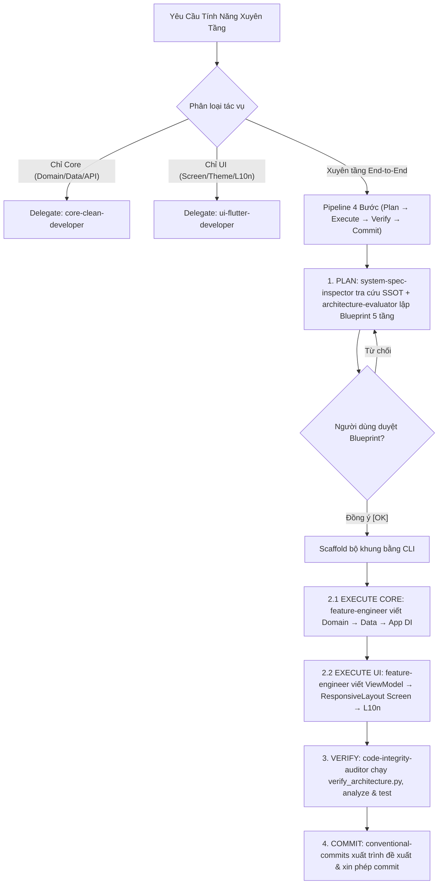

# KLTN Feature Lifecycle — Cross-Layer Clean Architecture Orchestrator

## Goal (Single Responsibility)
Skill điều phối cấp cao (**meta-orchestrator**) chuyên quản lý vòng đời tính năng **xuyên 5 tầng** -- chỉ kích hoạt khi tác vụ yêu cầu thay đổi đồng thời trên cả tầng lõi Backend Mobile ([`lib/domain/`](lib/domain), [`lib/data/`](lib/data), [`lib/app/provider.dart`](lib/app/provider.dart)) và tầng Giao Diện ([`lib/ui/`](lib/ui), [`lib/l10n/`](lib/l10n)). Skill này **không chứa chi tiết kỹ thuật triển khai cục bộ** -- thay vào đó ủy thác cho:
- Skill [`core-clean-developer`](.agents/skills/core-clean-developer/SKILL.md) cho phần Domain + Data + DI.
- Skill [`ui-flutter-developer`](.agents/skills/ui-flutter-developer/SKILL.md) cho phần UI + Responsive + L10n.

> [!IMPORTANT]
> **Phân ranh kích hoạt:** Nếu tác vụ chỉ nằm trong Core (UseCase, DTO, Mapper, API call) $\rightarrow$ dùng `core-clean-developer`. Nếu chỉ nằm trong UI (Screen, Widget, Responsive, Theme token, `.arb`) $\rightarrow$ dùng `ui-flutter-developer`. Chỉ dùng `feature-lifecycle` khi cần làm trọn gói CẢ HAI.

---

## Pipeline Xuyên 5 Tầng



---

## Ma Trận Phân Công Subagents Xuyên Tầng

| Giai Đoạn | Subagent Đảm Nhiệm | Trách Nhiệm Cốt Lõi |
|---|---|---|
| **Tra cứu đặc tả SSOT (FR/UC/API)** | [`system-spec-inspector`](.agents/agents/system-spec-inspector.md) | Trích xuất hợp đồng ABP, DTO fields, query params từ [`docs_api_clean_arch.md`](docs_api_clean_arch.md). |
| **Đánh giá kiến trúc & lập Blueprint** | [`architecture-evaluator`](.agents/agents/architecture-evaluator.md) | Thẩm định Architectural Impact Gate, lập sơ đồ Mermaid 5 tầng trình người dùng duyệt. |
| **Triển khai mã nguồn 5 tầng** | [`feature-engineer`](.agents/agents/feature-engineer.md) | Viết trọn vẹn Domain $\rightarrow$ Data $\rightarrow$ App DI $\rightarrow$ UI $\rightarrow$ L10n. |
| **Kiểm toán ranh giới, linter, tests** | [`code-integrity-auditor`](.agents/agents/code-integrity-auditor.md) | Chạy verify_architecture.py, flutter analyze, flutter test (tối đa 2 vòng verify-fix). |

---

## Decision Tree: Phân Loại Tác Vụ

```text
Yêu cầu triển khai hoặc cập nhật tính năng Flutter KLTN2026-2027
  │
  ├── Thay đổi CHỈ ảnh hưởng tầng Lõi Core (Domain / Data / API / DI)?
  │     └── Delegate cho skill core-clean-developer. DỪNG.
  │
  ├── Thay đổi CHỈ ảnh hưởng tầng Giao Diện (Screen / Widget / Theme / L10n)?
  │     └── Delegate cho skill ui-flutter-developer. DỪNG.
  │
  └── Thay đổi XUYÊN TẦNG (Core + UI)?
        │
        ├── 1. Tính năng mới hoàn chỉnh (ví dụ: Giải đấu Tournament, Đặt sân Booking)?
        │     └── Pipeline 5 Tầng: Tra cứu SSOT → Blueprint Mermaid → Scaffold CLI → Domain → Data → DI → UI (ResponsiveLayout) → L10n → Verify
        │
        └── 2. Cập nhật tính năng hiện có (Thêm trường dữ liệu hiển thị từ API lên Screen)?
              └── Ma Trận Đồng Bộ: DTO (defensive parsing) → Mapper → Entity (copyWith) → ViewModel (StateNotifier) → Screen Widget → L10n
```

---

## Bộ Công Cụ CLI Black-Box (Black-Box Tooling)

> [!IMPORTANT]
> **Sử Dụng Scripts Dạng Black-Box:** Không cần đọc mã nguồn Python vào context. Chạy trực tiếp từ CLI:

1. **Khởi Tạo Bộ Khung Tính Năng Mới (5 Tầng Chuẩn):**
   ```powershell
   python .agents/skills/feature-lifecycle/scripts/scaffold_clean_feature.py --name "<FeatureName>"
   ```
   *(Ví dụ: `--name Tournament` hoặc `--name BookingCourt`).*

2. **Tra Cứu Nhanh Yêu Cầu Chức Năng (FR01 - FR23) & Ca Sử Dụng (UC01 - UC20):**
   ```powershell
   python .agents/skills/feature-lifecycle/scripts/trace_system_spec.py --fr {FR01..FR23}
   python .agents/skills/feature-lifecycle/scripts/trace_system_spec.py --uc {UC01..UC20}
   python .agents/skills/feature-lifecycle/scripts/trace_system_spec.py --search "<từ_khóa>"
   ```

3. **Kiểm Tra Ranh Giới Tính Năng Vừa Tạo:**
   ```powershell
   python .agents/skills/feature-lifecycle/scripts/scaffold_clean_feature.py --validate "lib/ui/screen/<feature_name>"
   ```

---

## References & Examples
- [Ví Dụ Slice Tính Năng Mẫu](./examples/sample_feature_slice.md)
- [Quy Chuẩn Clean Architecture Flutter](./references/clean_architecture_conventions.md)
- [Ma Trận Ánh Xạ API Sang Clean Architecture](./references/api_mapping_matrix.md)
